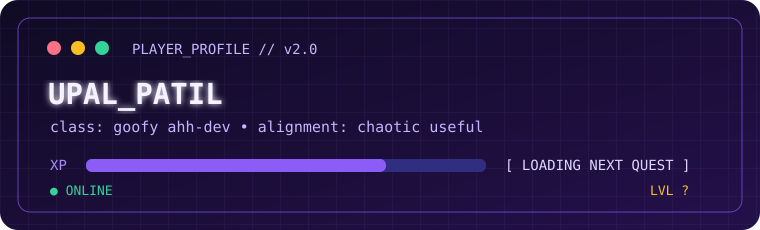

<div align="center">

# `UPAL_PATIL.exe`

### goofy ahh-dev.exe — a human-shaped side quest currently running in production.



<br />

`[ INITIALIZING ]` `████████████████████` `100%`

**Status:** online &nbsp;·&nbsp; **Class:** goofy ahh-dev &nbsp;·&nbsp; **Current quest:** make the internet stranger

</div>

---

## 🕹️ Player select

I’m **Upal Patil** — a goofy ahh-dev who likes turning blank screens, vague ideas,
and “this probably won't work” into things people can actually use.

I collect unfinished ideas, give them names, and occasionally ship them.

```text
┌─ ACTIVE LOADOUT ─────────────────────────────────────────────┐
│  main weapon     curiosity.exe                               │
│  passive skill   learns-by-building                           │
│  weakness        one-more-feature syndrome                     │
│  alignment       chaotic useful                               │
└───────────────────────────────────────────────────────────────┘
```

## 🧰 Equipped tech

`HTML` `CSS` `JavaScript` `React` `Next.js` `MySQL` `Supabase`
`Vercel` `Docker` `Apache` `Playwright` `Figma` `Adobe`

## 📜 Quest log

| Quest | Objective | Status |
|---|---|---|
| `CAMPUSCONNECT` | Make campus life less chaotic | `PLAYABLE` |
| `NOIRA` | Build something with mysterious main-character energy | `IN DEVELOPMENT` |
| `BLACK_CLOVER` | Craft a portfolio with more magic than a template | `SHIPPED / EVOLVING` |

## 🎒 Inventory

`💡 unfinished ideas` `🧪 tiny experiments` `📚 things currently being learned`
`🧃 suspicious amounts of caffeine` `🐛 bugs renamed as features`

## 🗺️ Map

| Level | Repository | Loot |
|---|---|---|
| `01` | [**Campusconnect**](https://github.com/upalpatil-inft-cmyk/CampusConnect) | community, utility, and fewer “where is this?” moments |
| `02` | [**Noira**](https://github.com/upalpatil-inft-cmyk/noira-skincare) | atmosphere, experiments, and suspiciously polished interfaces |
| `03` | [**Black Clover Portfolio**](https://github.com/upalpatil-inft-cmyk/black-clover-portfolio) | a personal portfolio with spell-casting energy |

The fastest way to understand how I think is to inspect the **pinned repositories**.
Each one is a small playable level: open the door, read the source, press the buttons,
report the bugs.

> **Recruiter / collaborator shortcut:** start with the project whose README has the
> best opening sentence. Good software should be easy to enter.

## 🏆 Achievement wall

- `UNLOCKED` — shipped a project before it felt “perfect”
- `UNLOCKED` — learned a new tool by building the wrong version first
- `UNLOCKED` — made a portfolio that refuses to be boring
- `LOCKED` — make a project with zero scope creep
- `SECRET` — still looking for the right achievement sound effect

## 📡 Signal

Want to team up, trade ideas, or send a delightfully unnecessary feature request?
Open an issue in a project or reach out through [LinkedIn](https://www.linkedin.com/in/upal-patil-a28704421).

`📨 upalpatil-inft@atharvacoe.ac.in` &nbsp;·&nbsp;
[GitHub](https://github.com/upalpatil-inft-cmyk) &nbsp;·&nbsp;
[LinkedIn](https://www.linkedin.com/in/upal-patil-a28704421)

<div align="center">

### `GAME OVER?` No. Save point reached.


</div>
